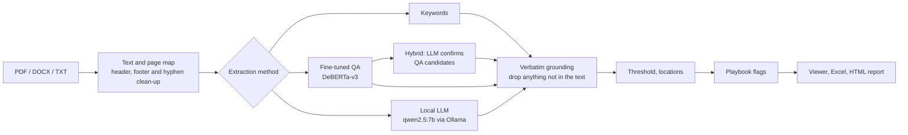

# ClauseScout

A local-first, first-pass contract review assistant for due diligence. It finds the 41 clause
types from the CUAD dataset, quotes every finding word for word with its page or paragraph,
flags risks against a YAML playbook, and exports a due diligence report (Excel plus an HTML
summary you can print to PDF).

**ClauseScout is a review aid, not legal advice.** It misses clauses and mislabels some. Every
finding is a verbatim quote, so it can be checked against the contract in seconds, and "not
found" never means "absent".

## Key findings

Validation results so far (62 CUAD contracts; the 102 test contracts are untouched until the
final method is chosen):

- The keyword baseline is hard to beat on contract-level precision (0.81 micro precision, 0.76
  micro F1) and runs in 0.13 s per contract on a CPU.
- A fine-tuned DeBERTa-v3-small (one epoch on a laptop GPU) ranks spans better at high recall
  (precision at 80% recall 0.17 against the keywords' 0), but its overall span AUPR (0.288) is
  below the keywords' 0.334, and its presence scores barely separate real clauses from absent
  ones.
- Saying "every clause is present" for every contract, with no quotes at all, scores a mean
  high-stakes F2 of 0.789. Any contract-level F2 should be read next to that number, so the
  tables include it as a reference row.

Final test numbers, with 95% bootstrap intervals and the CUAD paper's numbers alongside, are
added after the one test run.

## How it works



- **Grounding.** Every quote must be found in the contract text, with only typographic
  differences allowed (Unicode forms, curly quotes, soft hyphens, whitespace). Anything else is
  dropped and counted, so a method can't score with text the contract doesn't contain.
- **Locations.** Quotes are mapped to pages for PDFs and paragraphs for DOCX and TXT.
- **Playbook.** `clausescout/playbook/default.yaml` has 12 rules (uncapped liability, change of
  control termination, non-Singapore governing law, missing SIAC arbitration, missing PDPA
  language and so on). Rules that look at text CUAD doesn't label are marked unmeasured.

## Evaluation

The evaluation follows the CUAD paper's protocol and adds contract-level scores, which match the
question a due diligence report answers ("does this contract have a change of control clause,
and where?").

- **Split.** CUAD's 408 training contracts are split by contract into 346 train and 62
  validation (iterative stratification, seed 13). Every decision uses validation only. The 102
  test contracts are used once, at the end.
- **Span level.** AUPR and precision at 80% and 90% recall, exactly as in the paper.
- **Contract level.** Presence precision, recall, F1 and F2 per clause type, plus "found" (the
  clause is present and a correct quote was given) and found F2, which only counts a "yes"
  when it comes with a correct quote. Intervals are 95% bootstrap intervals over contracts.

### Checked against the official evaluate.py

My span metrics are a reimplementation, so I checked them against the official CUAD
`evaluate.py` functions on noisy random predictions over the validation contracts
(`scripts/crosscheck_official.py`). Over three trials, AUPR and precision at 80% and 90%
recall were identical to six decimal places, overall and for each clause type checked, including
the official quirks (duplicate texts keep the last probability, and the substring rule for
Parties).

## Running it on Windows

Tested on Windows 11 with Python 3.14 and an RTX 4050 laptop GPU (6 GB). The keyword method and
the app run on CPU only.

```powershell
git clone https://github.com/Lagatorase/clausescout
cd clausescout
py -3 -m venv .venv
.venv\Scripts\activate
pip install -r requirements.txt
pip install -e . --no-deps

# The app: API on 127.0.0.1:8000, serving the built frontend
cd web; npm ci; npm run build; cd ..
uvicorn api.main:app --host 127.0.0.1 --port 8000
```

Then open http://127.0.0.1:8000 and drop in some contracts. `config/app.yaml` picks the method.
For the local LLM, install [Ollama](https://ollama.com) and run `ollama pull qwen2.5:7b`.

With Docker: `docker compose up --build`, which publishes the app on 127.0.0.1 only.

Reproducing the experiments:

```powershell
python scripts/download_data.py                 # CUAD v1, CC BY 4.0
python scripts/run_experiment.py keywords-v1     # any name from experiments/experiments.yaml
python scripts/rescore.py keywords-v1            # threshold sweep on validation
python scripts/make_tables.py --split val --out reports/validation_tables.md
```

## Limitations

- CUAD is contracts filed by US public companies on EDGAR. Singapore contracts differ in drafting
  style and clause mix; the Singapore test set (15 public EDGAR contracts, in
  `datasets/singapore/`) is collected but not yet labelled, so there is no number for it yet.
- Scanned PDFs need OCR first. The app warns when a PDF has almost no text.
- Three playbook rules (arbitration, SIAC, data protection) search the whole text because CUAD
  has no label for them, so their accuracy is unmeasured.
- Presence thresholds are tuned on 62 validation contracts, so the validation scores are
  slightly optimistic. The test run is the honest number.

## Related projects

- [citebank](https://github.com/Lagatorase/citebank): questions over DBS, OCBC and UOB annual
  reports, with answers that cite the exact page.
- [credit-risk-scorecard](https://github.com/Lagatorase/credit-risk-scorecard): LightGBM against
  a WoE scorecard on Home Credit data, with reason codes and fairness checks.
- [birdlens](https://github.com/Lagatorase/birdlens): an on-device bird classifier for Android.

## License and data

Code under the MIT license. CUAD (Hendrycks, Burns, Chen and Ball, NeurIPS 2021,
[arXiv:2103.06268](https://arxiv.org/abs/2103.06268)) is licensed under
[CC BY 4.0](https://creativecommons.org/licenses/by/4.0/) and is downloaded, not redistributed.
