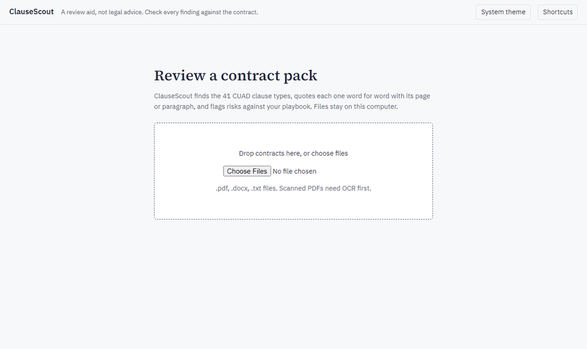
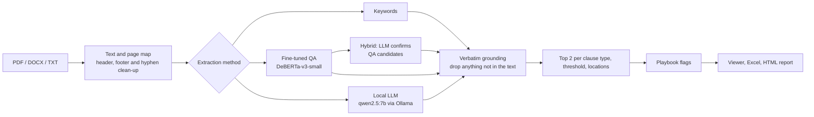
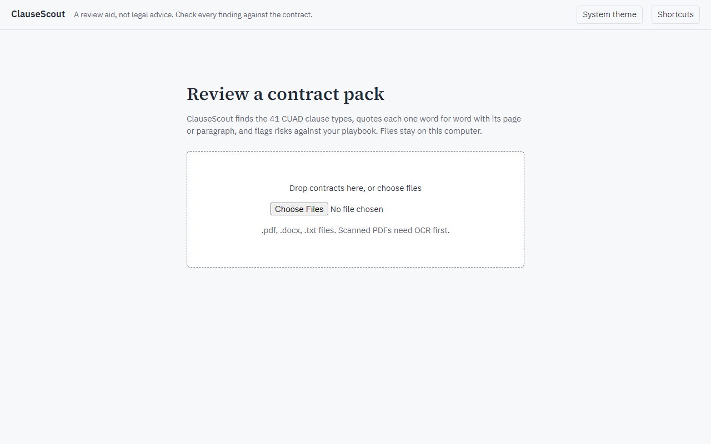
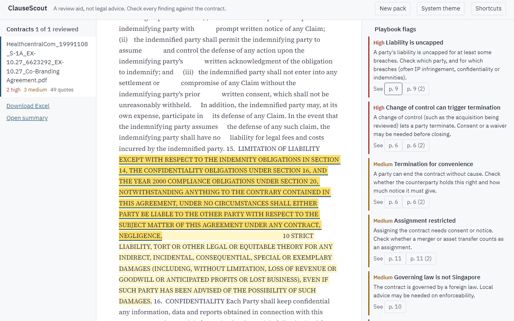
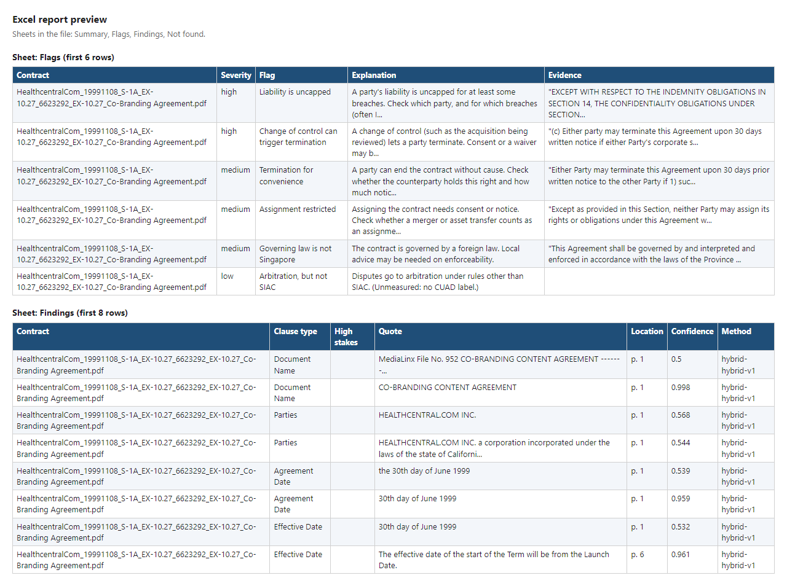

# ClauseScout

A local-first contract review assistant for due diligence: it finds 41 kinds of clause, quotes
each one word for word with its page, and flags risks against a playbook, all on your own machine.



*One CUAD validation contract through the selected hybrid. The wait while it runs (about 1.5
minutes per contract on the laptop) is cut from the recording.*

**ClauseScout is a review aid, not legal advice.** It misses clauses and mislabels some. Every
finding is a verbatim quote, so it can be checked against the contract in seconds, and "not
found" never means "absent".

## The problem

A due diligence review starts with the same questions for every contract in the data room: is
there a change of control clause, is liability capped, can the other side terminate for
convenience, which law governs it? Answering them by hand is slow, and the contracts are often
confidential, so sending them to a hosted model isn't always allowed. ClauseScout gives a first
pass that runs locally and only ever shows text that is really in the contract.

## Results

Validation (62 CUAD contracts). The selection metric is high-stakes found F2: F2 over eight
high-stakes clause types, where a "yes" only counts when it comes with a correct quote. Every
method shows at most its top 2 quotes per clause type. Intervals are 95% bootstrap intervals over
contracts.

| Method | High-stakes found F2 | Findings per contract | Span AUPR | Seconds per contract |
|---|---:|---:|---:|---:|
| Keywords (regular expressions) | 0.445 (0.384-0.504) | 19.1 | 0.334 | 0.1 (CPU) |
| Local LLM, qwen2.5:7b | 0.381 (0.315-0.440) | 12.9 | 0.168 | 153.7 |
| Fine-tuned QA, DeBERTa-v3-small, 1 epoch | 0.703 (0.636-0.759) | 61.2 | 0.288 | 48.9 |
| Fine-tuned QA, 4 epochs (seed 0) | 0.763 (0.696-0.820) | 41.8 | 0.391 | 52.4 |
| Fine-tuned QA, 4 epochs (seed 1) | 0.771 (0.712-0.819) | 44.5 | 0.399 | 48.9 |
| **Hybrid: the LLM checks the QA candidates (selected)** | **0.780 (0.717-0.833)** | **39.9** | **0.451** | 86.3 |

Times are on a laptop with an RTX 4050 (6 GB).

The hybrid was selected by the rule written down for it (below), but only on a tie-break: its
interval overlaps fine-tuned QA alone, which is simpler and about 1.6 times faster.

**Test (102 CUAD contracts, used once):**

| Method | High-stakes found F2 | Findings per contract | Span AUPR | Seconds per contract |
|---|---:|---:|---:|---:|
| Keywords (regular expressions) | 0.500 (0.432-0.568) | 16.2 | 0.321 | 0.1 (CPU) |
| Fine-tuned QA, 4 epochs (seed 0) | 0.752 (0.708-0.787) | 35.8 | 0.378 | 48.2 |
| **Hybrid (selected)** | **0.745 (0.698-0.782)** | **35.3** | **0.427** | 77.6 |

Each method uses the threshold chosen on validation. On test, the selected hybrid did not beat
fine-tuned QA alone: its found F2 is 0.007 lower, well within error, and QA alone is about 1.6
times faster. The hybrid still ranks quotes better (span AUPR 0.427 against 0.378) with slightly
fewer findings. Both are far ahead of keywords. The LLM alone was not run on test (about 4.5 hours
on this laptop).

## What I learned

- **The fine-tuned model beat the general-purpose local LLM by about 0.38 found F2** (0.763
  against 0.381). A 7B LLM that has never seen CUAD can't match a small model trained on it.
- **The LLM often doesn't quote word for word.** The grounding check rejected 36.7% of the local
  LLM's quotes (775 of 2,114) because they weren't in the contract exactly as written. For the
  fine-tuned QA model it rejected 0 of 50,840, because QA can only point at text that's there.
- **Training noise was small.** A second training seed differed by about 0.01 in found F2, while
  the intervals over contracts are about 0.11 wide. Most of the uncertainty comes from having only
  62 validation contracts.
- **My first selection rule could be gamed.** It used F2 on "is the clause present", and a dummy
  that says every clause is present, with no quotes at all, scored 0.789, level with the best
  model. I replaced it with found F2 (which that dummy scores 0 on) and a cap of 2 quotes per
  clause type, before any test contract was used, and wrote down why.
- **The local LLM wasn't reproducible run to run, even at temperature 0 with a fixed seed.** Two
  versions (before and after the answer cap) agreed on 87.2% of findings, and two identical runs
  of the same version agreed on 90.7%, so the variation comes from the model itself rather than
  the answer cap. The hybrid, whose answers are short, reproduced exactly. A local model also needs a cap on answer length: without one, a single
  answer that never ended stalled an overnight run.

## How it works



1. **Text.** PDFs, Word files and text files become plain text with a map back to pages (PDF) or
   paragraphs (DOCX and TXT). Repeated headers and footers and hyphenated line breaks are cleaned.
2. **Extraction.** The selected method is the hybrid: the fine-tuned QA model proposes candidate
   passages for each clause type, and the local LLM says which clause types each passage really
   is. Every quote is a span the QA model took straight from the contract. On test it scored level
   with QA alone, which is faster and needs no Ollama, so the app runs QA alone by default.
3. **Grounding.** Every quote must be in the contract word for word, allowing only typographic
   differences (Unicode forms, curly quotes, soft hyphens, whitespace). Anything else is dropped
   and counted.
4. **Review.** At most 2 quotes per clause type are shown, each with its page or paragraph, and a
   YAML playbook flags risks (uncapped liability, change of control termination, non-Singapore
   governing law, no SIAC arbitration, no PDPA language and so on).

## Design decisions

- **Local first.** Contracts never leave the machine by default. Hosted LLM backends are only
  built when `ALLOW_HOSTED_LLM=true` is set, so a contract can't be sent off by accident.
- **Quotes, not summaries.** A reviewer has to check every finding, and a verbatim quote with a
  page number is the fastest thing to check. Anything that isn't in the text is thrown away.
- **Found F2 as the selection metric.** A "yes" only counts with a correct quote, because that is
  what a reviewer acts on. F2 weights recall twice as much as precision, because a missed change
  of control clause costs more than an extra passage to read.
- **At most 2 quotes per clause type.** Without a cap, a method can win by quoting everything.
  Findings per contract is reported for every method as the reviewer's workload.
- **Ties go to the simpler setup.** When intervals overlap, the rule prefers fully local, then
  fewer findings to read, then faster.
- **One GPU job at a time.** A 6 GB laptop GPU can't hold the QA model and the LLM at once, so
  long runs go through a queue (`scripts/run_queue.py`) that resumes after a stop, and the app has
  a single background worker.

## How it was evaluated

- **Data.** CUAD v1: 510 commercial contracts with expert labels for 41 clause types.
- **Split.** CUAD's 408 training contracts are split by contract into 346 train and 62 validation
  (iterative stratification, seed 13), so no contract is in both. Every decision (thresholds,
  prompts, the method) uses validation only. The 102 test contracts are used once, at the end.
- **Span level.** AUPR and precision at 80% and 90% recall, as in the CUAD paper. My
  implementation matched the official `evaluate.py` to six decimal places on random predictions
  (`scripts/crosscheck_official.py`).
- **Contract level.** Presence precision, recall and F1 per clause type, plus found F2. Intervals
  are 95% bootstrap intervals over contracts.
- **Selection rule.** Each method's threshold is chosen on validation to maximise high-stakes
  found F2. The method with the highest score wins; if intervals overlap, the tie-breaks above
  decide. The full rule, the earlier rule it replaced and the reason are in
  [`reports/experiment_report.md`](reports/experiment_report.md).

## Setup

Tested on Windows 11 with Python 3.14 and an RTX 4050 laptop GPU (6 GB). The keyword method runs
on CPU only.

```powershell
git clone https://github.com/Lagatorase/clausescout
cd clausescout
py -3 -m venv .venv
.venv\Scripts\activate
pip install -r requirements.txt
pip install -e . --no-deps

# Frontend
cd web; npm ci; npm run build; cd ..
```

For the local LLM, install [Ollama](https://ollama.com) and run `ollama pull qwen2.5:7b`.

With Docker: `docker compose up --build`, which publishes the app on 127.0.0.1 only. The image
has no trained model, so it runs keywords.

## Usage

**The app.** Start the API, which also serves the built frontend, then open
http://127.0.0.1:8000 and drop in some contracts. The hybrid was the method selected by the
rule, but fine-tuned QA alone scored level with it on test and is faster with no Ollama, so the
app defaults to QA alone (`config/app-qa.yaml`, which needs the trained model in `models/`).
`config/app-hybrid.yaml` runs the hybrid (QA model plus Ollama), and `config/app-keywords.yaml`
runs keywords, which need no model at all.

```powershell
uvicorn api.main:app --host 127.0.0.1 --port 8000

# Or the hybrid, or keywords with no model
set CLAUSESCOUT_CONFIG=config/app-hybrid.yaml
set CLAUSESCOUT_CONFIG=config/app-keywords.yaml
```

Each contract gets its findings by clause type, with the quote highlighted in the text, the
playbook flags, and Excel and HTML downloads. Keyboard: j/k for quotes, n/p for contracts, t for
the theme, ? for help.

The screenshots use one CUAD validation contract (a 1999 co-branding agreement) and the hybrid.

| Upload | Results, with a flagged clause |
|---|---|
|  |  |

The Excel report (first rows of its Flags and Findings sheets):



**The experiments.**

```powershell
python scripts/download_data.py                 # CUAD v1, CC BY 4.0
python scripts/run_experiment.py keywords-v1     # any name from experiments/experiments.yaml
python scripts/rescore.py keywords-v1            # threshold sweep on validation
python scripts/make_tables.py --split val --out reports/validation_tables.md
python scripts/error_analysis.py keywords-v1     # examples of misses and false alarms
python scripts/run_queue.py                      # the long GPU jobs, one at a time
```

Every job in the queue resumes from its checkpoint or saved contracts, so the queue can be
stopped and restarted. A finished test job is never run again.

## Project structure

```
api/                  FastAPI app: upload, one background worker, results, downloads
clausescout/
  data/               CUAD loading and the train / validation / test split
  extraction/         keyword method and the method builder
  models/             fine-tuned QA (DeBERTa-v3)
  llm/                Ollama client, LLM method, hybrid, prompts
  grounding/          verbatim quote check and page or paragraph locations
  metrics/            span metrics (CUAD protocol) and contract metrics
  playbook/           YAML risk rules
  report/             Excel and HTML export
config/               which method the app runs (QA by default, the hybrid, or keywords)
datasets/singapore/   manifest of the Singapore contracts (labelling in progress)
docs/                 data notes, model card, screenshots
experiments/          experiment configs, splits and saved results
reports/              experiment report, tables, error analyses, progress log
scripts/              training, experiments, queue, tables, data tools
tests/                pytest suite
web/                  React and TypeScript frontend
```

## Limitations and next steps

- **CUAD is US public-company contracts** filed on EDGAR. Singapore contracts differ in drafting
  style and clause mix.
- **Singapore set: labelling in progress.** `datasets/singapore/manifest.yaml` lists 15 public
  Singapore-law commercial agreements from SEC EDGAR, with source URLs. To fetch them, set a
  User-Agent with your contact details (SEC requires one) and run the fetch script, then label
  them in the local labelling page, which starts with no labels and never shows model output:

  ```powershell
  set SEC_USER_AGENT=Your Name your.email@example.com
  python scripts/fetch_singapore.py
  python scripts/label_tool.py
  ```

  There are no Singapore results yet.
- **Scanned PDFs need OCR first.** The app warns when a PDF has almost no text.
- **Three playbook rules are unmeasured.** Arbitration, SIAC and data protection have no CUAD
  label, so those rules search the whole text and their accuracy isn't known.
- **Validation scores are slightly optimistic,** because thresholds were tuned on the same 62
  contracts. The test run is the honest number.
- **The local LLM isn't reproducible run to run,** even at temperature 0, so LLM results carry
  some noise beyond the intervals shown.
- **Next: DeBERTa-v3-base.** It was timed but not trained: about 0.7 hours per epoch on the
  laptop GPU (3.1 s per step), with a peak of 5.6 GB of the 6 GB. Four epochs would take about
  2.8 hours.
- **Next: a hosted LLM** (for example through the Anthropic API) as a further comparison. It
  wasn't run because it costs money.

## Related projects

- [citebank](https://github.com/Lagatorase/citebank): questions over DBS, OCBC and UOB annual
  reports, with answers that cite the exact page.
- [credit-risk-scorecard](https://github.com/Lagatorase/credit-risk-scorecard): LightGBM against
  a WoE scorecard on Home Credit data, with reason codes and fairness checks.
- [birdlens](https://github.com/Lagatorase/birdlens): an on-device bird classifier for Android.

## Licence and data credits

Code under the MIT licence (see `LICENSE`).

The Contract Understanding Atticus Dataset (CUAD) is by Dan Hendrycks, Collin Burns, Anya Chen
and Spencer Ball (NeurIPS 2021, [arXiv:2103.06268](https://arxiv.org/abs/2103.06268)), from The
Atticus Project, and is licensed under
[CC BY 4.0](https://creativecommons.org/licenses/by/4.0/). It is downloaded by
`scripts/download_data.py`, not redistributed here. The fine-tuned model is based on
`microsoft/deberta-v3-small` (MIT licence); the local LLM is Qwen2.5-7B-Instruct (Apache 2.0)
run through Ollama.
